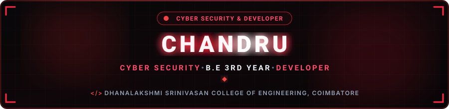
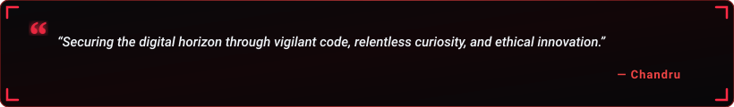

  

  

  
  &nbsp;
  
  &nbsp;
  

  

---

<h2 align="center">🔴 About Me</h2>

  

  

  Hey! I'm <b>Gojo</b>, a passionate <b>Cyber Security student &amp; developer</b> based in <b>Coimbatore, India</b>. 
  Currently pursuing my at <b>Dhanalakshmi Srinivasan College of Engineering, Coimbatore</b>. 
  I am a positive person and analytical thinker, enthusiastic about computer systems, network defense, database management, and developing modern secure applications.

  
  &nbsp;
  
  &nbsp;
  
  &nbsp;
  

  💬 <b>Let's Discuss:</b> Cyber Security, Python, Java, Web Technologies &amp; Database Security. 
  ⚡ <b>Philosophy:</b> <i>"A positive mindset and disciplined thinking turn every complex problem into an opportunity to learn and secure."</i>

<table width="100%" border="0" align="center">
<tr>
<td width="50%" align="center" style="padding: 14px;">
  <h4>🔭 Primary Focus</h4>
  
<b>Cyber Security &amp; Defense</b> Network Security, System Hardening &amp; Threat Analysis

</td>
<td width="50%" align="center" style="padding: 14px;">
  <h4>🌱 Active Deep Dives</h4>
  
<b>Python &amp; Java Development</b> Data Structures, APIs &amp; Secure Coding

</td>
</tr>
<tr>
<td width="50%" align="center" style="padding: 14px;">
  <h4>🎓 Academic Journey</h4>
  
<b>Dhanalakshmi Srinivasan College of Engineering</b> B.E Cyber Security (3rd Year) &bull; Coimbatore

</td>
<td width="50%" align="center" style="padding: 14px;">
  <h4>🤝 Collaboration &amp; Opportunities</h4>
  
<b>Open for Internships &amp; Projects</b> Cybersecurity research, development &amp; teamwork

</td>
</tr>
</table>

---

<h2 align="center">🔴 Featured Project Spotlight</h2>

<table width="100%" border="0" align="center">
<tr>
<td align="center" style="padding: 22px;">
  <h3>🛡️ sample-cyber-A.I</h3>
  
<i>A comprehensive handbook and reference guide of cybersecurity tool commands designed to aid security learners and developers in practical penetration testing and command-line workflows.</i>

   
  

    
    &nbsp;&nbsp;
    
  

</td>
</tr>
</table>

---

<h2 align="center">🛠️ Tech Stack &amp; Skills</h2>

<b>Core Programming Languages</b>

  

<b>Frontend Skills</b>

  

<b>Backend &amp; API Development</b>

  

<b>Database &amp; Data Security</b>

  

  
  &nbsp;
  
  &nbsp;
  

<b>Tools &amp; Environments</b>

  

---

<h2 align="center">📊 GitHub Analytics &amp; Activity</h2>

  
  &nbsp;&nbsp;
  

  

  

---

<h2 align="center">⚡ Contribution Journey</h2>

  

---

<h2 align="center">📬 Let's Connect &amp; Collaborate</h2>

<i>Whether you want to discuss cybersecurity, explore collaborative software projects, or connect — my inbox is always open!</i>

<table border="0" align="center">
<tr>
<td align="center" width="220" style="padding: 16px;">
  <a href="https://instagram.com/prince_072003" target="_blank">
    
      
    
  </a>
   
  <b>Social &amp; Updates</b>
</td>
<td align="center" width="220" style="padding: 16px;">
  <a href="mailto:chandruv072003@gmail.com">
    
      
    
  </a>
   
  <b>Direct Communication</b>
</td>
<td align="center" width="220" style="padding: 16px;">
  <a href="https://github.com/Root-Wolf-07" target="_blank">
    
      
    
  </a>
   
  <b>Code &amp; Repositories</b>
</td>
</tr>
</table>

  

